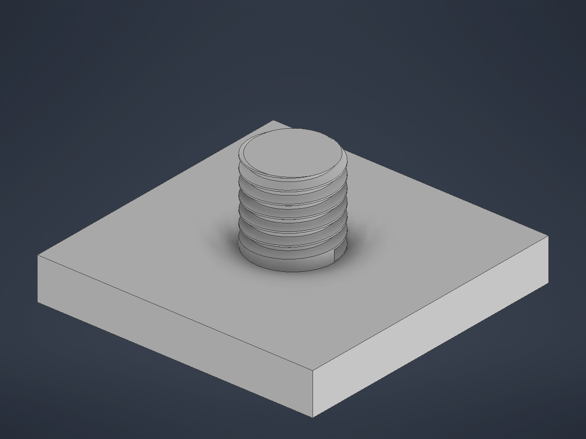
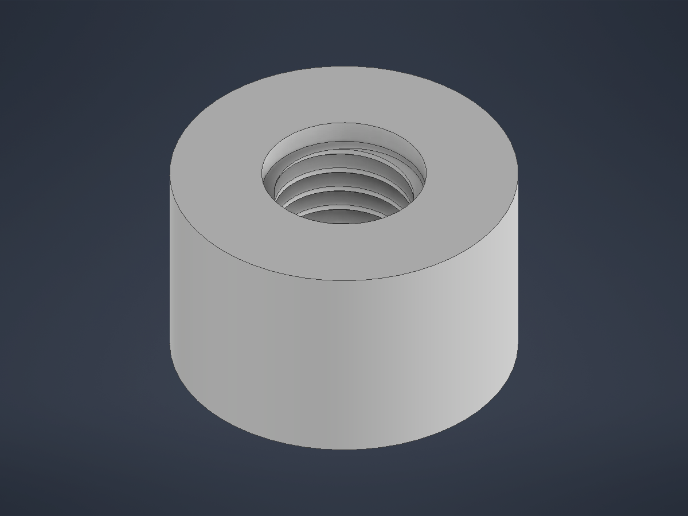

# Printable threads for Autodesk Inventor

An iLogic rule for placing modeled, editable threads in a single-solid Inventor part. It creates either female threaded holes or male threaded studs at the hole-center points of a sketch on a planar face. The threads are real geometry suitable for STL export, rather than cosmetic thread annotations.

The rule uses ordinary Inventor sketches, extrusions, coils, and parameters. The male option creates a **new stud** on the chosen face; it does not thread an existing shaft.

## Requirements

- Autodesk Inventor with iLogic. The supplied rule was developed and checked in **Inventor 2027**; compatibility with other versions has not been verified.
- A part (`.ipt`) containing **exactly one solid body** and a planar face with enough material for the intended features.
- A 2D sketch created **directly on that face**, containing one or more non-reference **hole-center points**. Ordinary construction points are not placement points.

## Install and run

1. Download or clone the repo (or use **Code → Download ZIP**) and keep `Place_Printable_Thread.iLogicVb` somewhere accessible.
2. Open your target `.ipt` in Inventor. Create a 2D sketch on the face where the threads will go, add and dimension the hole-center points, then finish the sketch.
3. Show **Manage → iLogic → iLogic Browser** if needed. In **External Rules**, right-click the top node, choose **Add External Rule**, and select `Place_Printable_Thread.iLogicVb`. You only need to add it again if you move the file or use another computer.
4. Select the placement sketch by clicking its name in the model browser, then run the external rule. If you did not preselect it, the rule prompts you to pick a sketch.
5. Choose **Female hole** or **Male stud** and enter the nominal diameter (`D`), pitch (`P`), requested length (`L`), and radial clearance (`C`) in millimeters.

Every hole-center point in the chosen sketch gets a thread. To use different sizes or lengths, create separate placement sketches and run the rule separately for each group. Each run creates its own parameter set.

## Parameters and fit

Find the generated parameters under **Manage → Parameters**. The first run normally uses the prefix `PT01`; later runs use `PT02`, and so on.

| Parameter | Meaning | Example for M12 × 1.75 |
| --- | --- | ---: |
| `PT01_D` | Nominal major diameter | 12 mm |
| `PT01_P` | Pitch of the single-start thread | 1.75 mm |
| `PT01_L` | Requested thread travel (female) or stud height (male) | 12 mm |
| `PT01_C` | Radial printing clearance applied to this part | Female: 0.15 mm; male: 0 mm |

Set both `D` and `P` explicitly: changing the diameter does not automatically select a standard pitch. For a mating pair, use the same `D`, `P`, and right-handed thread direction. Choose the two lengths independently.

Positive female `C` enlarges the internal thread; positive male `C` shrinks the external thread. The added radial gap of a pair is **female `C` + male `C`**, and the corresponding diameter difference is twice that value. For example, and as a suggested starting point for most thread pairs, female `C = 0.15 mm` and male `C = 0 mm` add 0.15 mm radial clearance (0.30 mm diametral difference). The suggested values are only a starting point: print a short test pair with your actual printer, material, orientation, and settings, then adjust the fit.

### Female hole depth

The rule cuts a pilot hole to **`L + P`** to allow thread runout. It also makes a straight, unthreaded entrance relief one pitch deep at the internal thread's major radius. For `L = 12 mm` and `P = 1.75 mm`, the pilot extends 13.75 mm before any retained floor. Provide additional stock thickness for a blind bottom. The full-profile engagement is shorter than `L` because of the entrance and end geometry; if the cut reaches the opposite face, the hole becomes a through opening.

### Male stud geometry

The boss projects outward from the selected face and joins the existing solid. The coil cut extends past the tip to complete its thread. There is no configurable shoulder, tip chamfer, or rounded runout. Check surrounding stock, stud spacing, and the actual mating geometry before printing.

## Edit a placed thread

Edit its generated `PT…_D`, `PT…_P`, `PT…_L`, or `PT…_C` values in **Manage → Parameters**, then update the model. All points from the same run share those parameters. To move a thread, edit the dimensions locating its hole-center point in the original placement sketch.

**Do not rerun the rule to resize or move an existing thread.** Every run creates another set of features, which can overlap the original ones. Adding new points to an already used sketch does not create more threads automatically; use a new placement sketch and run the rule for the new locations. Removing a referenced point can break its dependent features.

## Disclaimer

The generated profile is a basic **right-handed, single-start 60° thread with flat roots**. The rule does not assign an ISO tolerance class (such as 6H or 6g) or support left-handed, multiple-start, tapered pipe, or ACME/trapezoidal threads.

Before exporting an STL, inspect a close-up or section view to confirm the crests and grooves are modeled. Choose an STL mesh resolution that preserves the thread flanks and inspect the mesh in your slicer.

## Inspiration
- [3D Printable Threads in Autodesk Inventor — The CADWhisperer](https://www.youtube.com/watch?v=57t7E7lOdvM) (the rule was implemented loosely following the above video)
